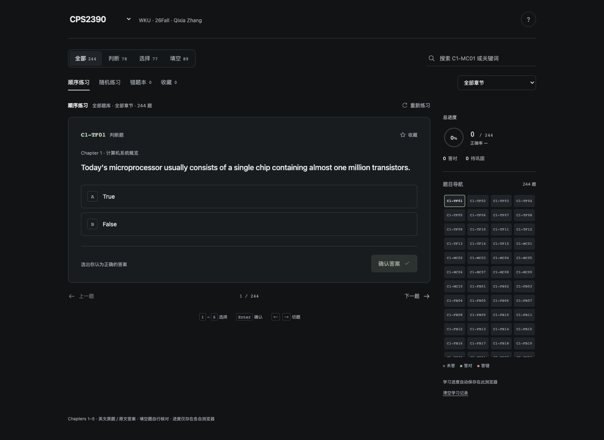

# WKU-CPS2390-26Fall

**Wenzhou-Kean University · CPS2390 · Qixia Zhang · Fall 2026 (26Fall)**

[Practice online](https://wangzeyu2006729-beep.github.io/WKU-CPS2390-26Fall/) · [Other course: MATH3700](https://wangzeyu2006729-beep.github.io/WKU-MATH3700-26Fall/)

244 TestBank questions across Chapters 1–5: 78 true/false, 77 multiple choice, and 89 fill-in-the-blank questions. This is one of the repository owner's Fall 2026 courses at WKU. Both course sites use a compact dark interface and independent browser progress.



## Course information

| Field | Details |
|---|---|
| University | Wenzhou-Kean University (WKU) |
| Course | CPS2390 |
| Instructor | Qixia Zhang |
| Semester | Fall 2026 (26Fall) |

Use the course selector at the top to switch between MATH3700 and CPS2390. Questions are in English; controls and supplementary study notes are in Chinese. This is an independent revision aid, not an official university site or a statement of instructor endorsement.

## Coverage

| Chapter | Topic | True/false | Multiple choice | Fill in the blanks | Total |
|---|---|---:|---:|---:|---:|
| 1 | Computer systems | 15 | 10 | 20 | 45 |
| 2 | Data representations and operations | 15 | 15 | 22 | 52 |
| 3 | Digital logic | 15 | 14 | 20 | 49 |
| 4 | The von Neumann model | 18 | 19 | 14 | 51 |
| 5 | LC-3 ISA | 15 | 19 | 13 | 47 |
| **Total** | | **78** | **77** | **89** | **244** |

## Practice controls

- Combine chapter and question-type filters with sequential, random, incorrect-answer, or bookmarked practice.
- Labels preserve chapter, type, and original number: `C1-TF01`, `C1-MC01`, `C1-FB01`. Search a complete label or keyword; a bare number searches the internal sequential ID.
- True/false and multiple choice are graded against the supplied answer key. All original choices are retained, including five- and six-option questions.
- Fill questions offer an optional input for each blank. Reveal the original reference answers, compare your response, then choose **答对了** or **需巩固**. Revealing alone does not count as completion; self-assessment avoids rejecting equivalent terms.
- Keyboard: `1`–`6` or `A`–`F` select; `Enter` confirms; arrow keys navigate; `S` bookmarks. Enter in a fill field reveals its reference answers.

Incorrect-answer review collects the latest mistakes; a correct retry removes a question when the list is refreshed. Restarting hides solutions while retaining previous records. Clearing course progress requires confirmation.

## Source material and editorial notes

The supplied files are `chap01tq.doc` through `chap05tq.doc`, headed Patt/Patel, *Introduction to Computing Systems: From Bits and Gates to C and Beyond*, 2e. Qixia Zhang is the instructor identified by the repository owner, not the asserted author of the textbook bank.

- `sources/`: extracted source text and original-file SHA-256 hashes; the local Word documents remain unchanged.
- `source-audit.json`: per-file counts, types, and original numbers.
- `build.py`: parses all questions and removes inline fill answers while preserving contextual parentheses such as `a(n)`.

Chapter 2 repeats fill-question numbers 3 and 4; the second occurrences use `C2-FB03b` and `C2-FB04b`. Chapter 3 omits multiple-choice 11; Chapter 5 omits multiple-choice 17. No supplied question is dropped and no missing question is invented.

Original keys are retained, with editorial notes where issues are identified. In particular, `C2-MC02` incorrectly treats a carry from adding negative two's-complement integers as sufficient evidence of signed overflow. The interface flags this with a counterexample while retaining the source key for grading. This does not imply that every source key has been independently corrected.

## Progress and privacy

Records stay in the current browser's localStorage under `cps2390-testbank-v1`. There is no backend, account, tracking, or answer upload. The other course uses its own key; switching courses or clearing one course does not clear the other.

Typed fill drafts, pending reference-answer reveals, self-assessment results, bookmarks, and position survive refresh.

The repository rename changes the page path but keeps the same GitHub Pages hostname and storage key, so existing online records remain available in the same browser profile. Different devices, browsers, and profiles have independent records; tabs in one profile share them. There is no cross-device synchronization. Clearing browser data removes progress; private browsing may discard it on close. If storage is unavailable, practice remains usable for that session with a warning.

## Build and offline use

`index.html` embeds the full interface and question bank. Download it and open it to practice offline. Online and offline copies have separate browser storage; switching to the other online course requires an internet connection.

Rebuild with Python 3, without third-party Python dependencies:

```bash
python3 build.py
```

`template.html` contains the interface; `questions.json` and `index.html` are generated outputs.

## Verification

Serve locally and use a disposable test browser profile; the functional checks clear that profile's progress:

```bash
python3 -m http.server 8000 --bind 127.0.0.1
npx --yes --package @playwright/cli playwright-cli -s=cps2390 open http://127.0.0.1:8000/index.html
npx --yes --package @playwright/cli playwright-cli -s=cps2390 run-code --filename verify-browser.js
npx --yes --package @playwright/cli playwright-cli -s=cps2390 run-code --filename verify-isolation.js
```

Checks cover question navigation and grading, filters, persistence, storage-denied operation, and layouts from 320 to 1440 pixels. Isolation checks use independent browser contexts. See `docs/verification.json` and the additional course checks in `docs/` for verified results.

## License and attribution

Application code is provided under the [MIT License](LICENSE). Original course questions and answer keys retain their respective authors' rights; the code license does not relicense those materials. See [CONTENT_NOTICE.md](CONTENT_NOTICE.md).
